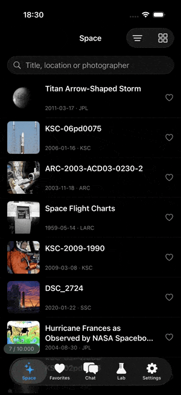
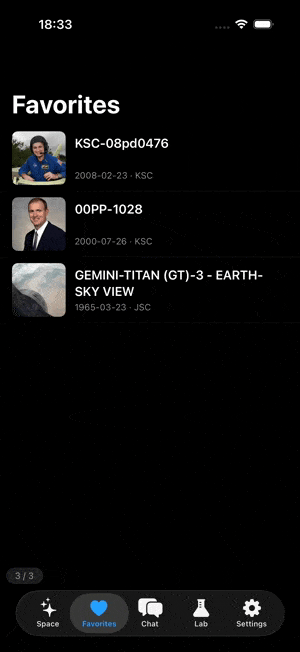

# KPage

[](https://central.sonatype.com/artifact/io.github.wladyslawpopov/paging-core)
[](https://github.com/WladyslawPopov/KPage/actions/workflows/tests.yml)
[](LICENSE)

**Offline-first pagination for Kotlin Multiplatform.** For `page` / `limit` APIs, with a local SQLDelight cache and no UI dependency: use it with Compose, SwiftUI, UIKit or Android Views.

- The list is always read from the local database: after a restart it shows at once, and when the network fails the cache stays on screen.
- The user can scroll anywhere: the list is `totalCount` long, unloaded positions are `null` placeholders.
- The window around the user's position is refreshed in one transaction: no mix of old and new rows, no jump to the top.
- One call, `updateItem`, changes an item in every list that shows it.

Runs in production Android and iOS apps and is proven by thousands of users.

Targets: **Android**, **iOS** (`iosArm64`, `iosSimulatorArm64`), **JVM / Desktop**.

## See it in action

Short clips of the [demo app](demo/) on KPage, Android on the left and iOS on the right. The details and longer videos of every screen are in the [demo README](demo/README.md#screens).

<table>
  <tr>
    <td align="center"><br><sub>Android</sub></td>
    <td align="center"><br><sub>iOS</sub></td>
  </tr>
</table>

**Working with the listing.**

<table>
  <tr>
    <td align="center"><br><sub>Android</sub></td>
    <td align="center"><br><sub>iOS</sub></td>
  </tr>
</table>

**Working with favorites.**

<table>
  <tr>
    <td align="center"><br><sub>Android</sub></td>
    <td align="center"><br><sub>iOS</sub></td>
  </tr>
</table>

**Working with the chat.**

> **See it working:** [`demo/`](demo/) is a complete Android + iOS app on this library (NASA image search, favorites, a chat with a mock server, settings) with shared logic and fully native UI. [Jump to the demo](#demo).

**On this page:** [Install](#install) · [Quick start](#quick-start) · [API at a glance](#api-at-a-glance) · [Guide](#guide) · [Demo](#demo)

## Why KPage

| Problem | What KPage does |
|---|---|
| A long list should not be loaded or kept whole | Keeps a window of pages around the visible position in memory and in the database; the rest is deleted |
| The server shifts items while the user scrolls | Items are addressed by server position (`page * pageSize + index`), so a shifted page leaves no holes |
| A refresh must not break the screen | Reloads the whole window, replaces it in one transaction, keeps the old data on screen until then; on failure nothing changes |
| One item is shown in several lists (a tab, a search, a favorites list) | Items are stored once per type; `updateItem` reaches every list, open ones too |
| Offline start | Cached list and `totalCount` are shown before the first request |
| Different UI toolkits | The library draws nothing; any UI reports its visible rows through a small tracker |

KPage is built for APIs where any page can be requested by its number, and everything above relies on that. Cursor-based APIs ("give me the items after X") are a different model and out of scope.

## Install

```kotlin
kotlin {
    sourceSets {
        commonMain.dependencies {
            implementation("io.github.wladyslawpopov:paging-core:2.1.0")
        }
    }
}
```

Built with Kotlin 2.4 and SQLDelight 2.4. The library has no Compose dependency; kotlinx.serialization and the SQLDelight coroutine extensions come with it (their types are part of the API).

If your iOS app links the Kotlin framework statically, add `-lsqlite3` to the linker flags.

### The database

One `PagingDatabase` for the whole app, shared by all paginators. Create it in platform code:

```kotlin
// Android
val db = PagingDatabase(createPagingDriver(context))

// iOS: stored in Caches, not backed up to iCloud
val db = PagingDatabase(createPagingDriver())

// JVM / Desktop: the app chooses the directory
val db = PagingDatabase(createPagingDriver(File(System.getProperty("user.home"), ".myapp")))
```

For tests and previews use `createInMemoryPagingDriver()` (on Android it takes a `Context`). The cache is disposable: when a new version changes the schema, the library opens a new file and deletes the old ones. Nothing is migrated.

## Quick start

### 1. The API call

Items are stored as JSON, so the type must be `@Serializable`. `getPage` returns a `PagerPayload`:

```kotlin
@Serializable
data class User(val id: String, val name: String, val isLiked: Boolean = false)

suspend fun getUsers(page: Int, pageSize: Int): PagerPayload<User> {
    val response = api.users(page = page, limit = pageSize)
    return PagerPayload(
        totalCount = response.total,   // or null if the API does not report it
        isMore = response.hasNext,
        objects = response.items,
    )
}
```

`getPage` receives `page + initialPageKey`: set `initialPageKey = 1` if your pages start at 1.

### 2. The paginator

Create it where the list is owned (a ViewModel, a component, a presenter) and pass that owner's scope:

```kotlin
class UsersHolder(api: UsersApi, db: PagingDatabase, scope: CoroutineScope) {
    private val config = PaginatorConfig(pageSize = 30)

    val paginator: Paginator<User> = StablePaginator(
        serializer = User.serializer(),
        queryKey = "users",           // the name of this list in the cache, never sent to the server
        config = config,
        getPage = { page -> api.getUsers(page, config.pageSize) },
        idExtractor = { it.id },
        db = db,
        scope = scope,
    )

    val state: StateFlow<PagingState<User>> = paginator.state
}
```

`paginator.state` has everything the UI needs, read from one database snapshot:

- `items: PagedList<T>`: `size == totalCount`, `null` is a placeholder;
- `totalCount`: restored from the cache on a cold start;
- `loadState`: see [Loading state](#loading-state);
- `isRestored`: `false` until the cache has been read, so an empty list before that means "not read yet".

The paginator loads its first window by itself and refreshes it once when it is created. After that the refresh is yours: you call `refresh()` at the moments your business logic needs it (see [Refresh](#refresh)).

### 3. The list

The UI does two things: draws `items`, and tells the paginator which rows are on screen with a `PagingListTracker`. In Compose that is a short helper:

```kotlin
@Composable
fun TrackVisibleRows(state: LazyListState, rows: PagingRowSource, events: PagingEvents) {
    val currentRows by rememberUpdatedState(rows)
    val tracker = remember(events) { PagingListTracker(events) }
    LaunchedEffect(state, tracker) {
        snapshotFlow { VisibleRows(currentRows, state.layoutInfo.visibleItemsInfo.map { it.index }) }
            .collect { tracker.onLayout(it.rows, it.indexes) }
    }
}

// Not a data class: snapshotFlow would compare the rows with equals on every change.
private class VisibleRows(val rows: PagingRowSource, val indexes: List<Int>)
```

```kotlin
@Composable
fun UsersScreen(holder: UsersHolder) {
    val state by holder.state.collectAsState()
    val listState = rememberLazyListState()
    val rows = remember(state.items) { state.items.rows() }
    val keys = remember(rows) { rows.keys { it.id } }

    TrackVisibleRows(listState, rows, holder.paginator)

    LazyColumn(state = listState) {
        items(count = rows.rowCount, key = keys) { index ->
            state.items[index]?.let { UserRow(it) } ?: UserRowPlaceholder()
        }
    }
}
```

Two rules:

- **The rows you pass to the tracker are exactly the rows of the lazy list**, in the same order. Add headers and separators with [`decorate`](#headers-separators-local-rows), not with a separate `item { }`, or the positions shift.
- **Keys must be unique.** When the server shifts its pages, the same item can briefly sit on two positions, and duplicate keys crash a lazy list. `rows.keys { it.id }` keeps the id and adds the position only to a repeated one, so rows stay stable when new items shift the list.

SwiftUI and UIKit use the same tracker: the demo's [`PagedGrid.swift`](demo/iosApp/iosApp/Paging/PagedGrid.swift) is a complete example, see [UI without Compose](#ui-without-compose).

## API at a glance

| Task | Call | Notes |
|---|---|---|
| Show the list | `paginator.state` | `items`, `totalCount`, `loadState`, `isRestored` |
| Report what is on screen | `PagingListTracker(events).onLayout(rows, visibleRows)` | on every layout change |
| Refresh | `refresh()` | where the user is: pull-to-refresh, retry, after removing items on the server; returns when it is over |
| Refresh from the top | scroll to the top, then `refresh()` | the window follows the scroll |
| Jump to a position | scroll the list | the window follows by itself |
| Read the full item | `getItemById(id)` | when rows hold a display model |
| Change one item | `updateItem(id) { it.copy(...) }` | after the server confirmed; every list sees it |
| Change an item without a paginator | `db.updateItem(serializer, id) { ... }` | for example from a details screen |
| Remove items | server call, then `refresh()` | no local shifting |
| Headers, separators, local rows | `state.items.decorate { ... }` | returns `PagingRows` |
| Manage the cache | `db.clearCache()`, `db.setMaxLists(n)`, `db.cacheStats()` | |
| Stop | cancel the owner's scope | `close()` only to replace a paginator earlier |

## Guide

Every chapter starts with what you need; the details are folded.

### The window

The paginator keeps the **visible pages** plus `prefetchDistance` pages on each side loaded (default `1`: about 3 pages on a phone). When the user scrolls to another page, only the missing pages are requested and loads outside the window are cancelled. Besides the window, `extraPagesInDb` (2) nearest pages stay in the database for scrolling back; farther pages are deleted.

### Refresh

```kotlin
scope.launch {
    paginator.refresh() // returns when the refresh is over
}
```

One refresh, and it works **where the user is**: it requests the pages of the current window again, ignoring the cache, and replaces them in one transaction. The old data stays on screen meanwhile (`loadState = REFRESH`).

One rule for the whole API: `state` tells what is going on with the list, and the calls of the app (`refresh()`, `updateItem()`, `getItemById()`) suspend until they are done. A pull-to-refresh indicator simply stays until `refresh()` returns.

<details>
<summary>Details</summary>

- When every page of the window has answered, one transaction replaces the list, updates `totalCount` and drops the pages outside the window (they are stale and load again when the user scrolls there).
- If any page fails, everything received is thrown away: the cache and the position stay, `loadState = ERROR`, and a retry button can call `refresh()` as often as needed.
- If the list got shorter than the user's position, the refresh moves to the new end. A failure of a page past the real end does not fail the refresh.
- `refresh()` returns when the new data is written, when it failed (the error is in `state`, not thrown), or when a scroll out of the window or `close()` ended it. It never waits forever.
- Scrolling out of the window during a refresh cancels it; calling `refresh()` again restarts it. A refresh asked while another runs replaces it, and both calls return when the new one is over.
- The library never touches the scroll position.
- **You decide when the list is renewed.** The paginator refreshes once when it is created (over a cache it refreshes the window at the start and drops deep cached pages). After that `refresh()` is yours: call it on a pull, on a retry, on a signal of your business logic (a cleared cache, a changed favorite) or when the screen comes back, one line wherever your app needs it. Nothing renews behind your back, so counters and positions stay exactly as the user sees them until you decide. A changed query is a new paginator with a new `queryKey`.
- An empty list ("nothing found") is renewed only by `refresh()` as well.
- `getPage` must only read: pages of one refresh are loaded in parallel and the length is taken from the last page, so a side effect inside `getPage` makes the total disagree with the list.

</details>

### Loading state

| State | When | What to show |
|---|---|---|
| `INITIAL` | loading with nothing to show (no cache) | a full-screen loader |
| `REFRESH` | refreshing over the shown cache | a subtle indicator, or nothing |
| `NEXT` | pages of the window loading while scrolling | placeholders |
| `IDLE` | the window is loaded, more data after it | nothing |
| `END` | the window is loaded and reaches the end | `totalCount == 0` means "nothing found" |
| `ERROR(error)` | the last load failed; the cache is intact | an error with a retry that calls `refresh()` |

```kotlin
when (val load = state.loadState) {
    LoadState.INITIAL -> FullScreenLoader()
    is LoadState.ERROR -> ErrorBanner(load.error.message, onRetry = paginator::refresh)
    else -> Unit
}
```

### APIs without `totalCount`

Pass `totalCount = null`. The list is then as long as its loaded part, with no placeholders after it; the next page is requested when the user nears the end; the end is a page with `isMore = false` or fewer items than `pageSize` (`loadState = END`). The loading indicator at the bottom is yours, for example a [footer](#headers-separators-local-rows).

### Changing items

```kotlin
fun onLikeClick(id: String) = scope.launch {
    api.addToFavourites(id)                               // the server first
    paginator.updateItem(id) { it.copy(isLiked = true) }  // then the cache
}
```

Items are stored once per type and shared by all lists, so the change appears at every position in every list. `updateItem` returns the new item, or `null` if it is not cached.

**Removing** is a server operation, often over a selection that is not even in the cache, so there is no `removeItem`: delete on the server, then `refresh()`.

<details>
<summary>Details</summary>

- `transform` gets the current cached version; reading and writing happen in one step. `updateItem(id) { newItem }` replaces the whole item. An exception thrown by `transform` goes to the caller. JSON in the cache that cannot be read gives `null` and is kept.
- A load of this paginator that started before the edit does not overwrite it. A load of another list that was already in flight when you edited may deliver the older version: call that list's `refresh()` if the screen needs the new one at once. The same holds for `PagingDatabase.updateItem`, which has no paginator of its own.
- `getItemById(id)` reads the full item from the cache, for example when rows hold only a display model and a server call or a details screen needs the whole item. Keep no copies of items of your own.

</details>

### Headers, separators, local rows

Without extra rows use `items.rows()`. For extra rows use `decorate`. Every decoration is placed **before a server position** (`0..items.size`); only loaded items and decorations are visited, so the cost does not depend on `totalCount`:

```kotlin
val rows = remember(state.items, promos, drafts) {
    state.items.decorate<Post, FeedDecor> {
        if (promos.isNotEmpty()) header(FeedDecor.Banner(promos))        // before position 0
        between { prev, next ->                                          // both neighbours loaded
            if (prev.day != next.day) FeedDecor.Date(next.day) else null
        }
        drafts.forEach { insert(beforeIndex = 0, FeedDecor.Local(it)) }  // anchored rows
        footer(FeedDecor.End)                                            // after the last position
    }
}
val keys = remember(rows) { rows.keys { it.id } }

LazyColumn(state = listState) {
    items(count = rows.rowCount, key = keys) { i ->
        when (val row = rows[i]) {
            is PagingRow.Item -> row.item?.let { PostRow(it) } ?: PostPlaceholder()
            is PagingRow.Decoration -> DecorRow(row.value)
        }
    }
}
```

<details>
<summary>Details</summary>

- `decorate` returns `PagingRows`, not a `List`: use `rows.rowCount` and `rows[i]`. It is not a list on purpose: Kotlin/Native turns every `List` into an `NSArray`, so SwiftUI would get a converted copy. `PagingRows` crosses by reference and is read row by row.
- Decorations at the same position keep the order of the calls. `between` is called only for neighbours that are both loaded.
- A position outside the list (computed from an older snapshot) is clamped, not a crash.
- A decoration is keyed by its position and order; pass `decorationKey` to `keys` to key it by your own identity. A placeholder is keyed `slot:N`.
- Build `keys` once per rows (`remember(rows) { ... }`): it walks the loaded items.
- To find the position of an item, walk `items.loadedIndices`, not the whole list.
- Your own row types can implement `PagingIndexedItem` (server rows return their server index, decorative rows `null`) and be passed through `PagingRowSource.of(list)` when you do not use `decorate`.

</details>

### UI without Compose

The tracker needs one call, `onLayout(rows, visibleRows)`, from wherever the UI learns what is on screen. In SwiftUI the demo uses `onScrollTargetVisibilityChange`, in a few lines:

```swift
tracker = events.map { PagingListTracker(events: $0) }          // a new paginator gets a new tracker
tracker.onLayout(rows: list.rows, visibleRows: visible.map { KotlinInt(int: Int32($0)) })
```

<details>
<summary>Details</summary>

- Create one tracker per `events` object (the paginator itself): a new paginator gets a new one. Call it from the main thread.
- Repeated calls are cheap: only the visible rows are read and an unchanged range is not sent again. Before the first layout a non-empty list has no visible rows yet, and nothing is sent.
- In SwiftUI identify rows by position (`ForEach(0..<rowCount)`): the rows are read by index and the identity of every row is read on each update.
- Complete examples: [`PagedGrid.swift`](demo/iosApp/iosApp/Paging/PagedGrid.swift) (SwiftUI) and [`TrackVisibleRows.kt`](demo/androidApp/src/main/kotlin/io/github/wladyslawpopov/kpage/demo/android/ui/paging/TrackVisibleRows.kt) (Compose).

</details>

### Lifecycle and dispatchers

**The paginator lives exactly as long as its `scope`.** Cancel the owner's scope and loads, the database subscription and event handling stop; there is nothing to call. `close()` stops one paginator earlier than its owner, typically when it is replaced after a filter change.

<details>
<summary>Details</summary>

- A cancelled scope fails at creation.
- The same list on several screens (the same `queryKey` alive twice) is fine: every extra live paginator keeps its pages separately, so the screens do not delete each other's data.
- `dispatcher` (`Dispatchers.Default`) runs events, JSON decoding and `getPage` calls; do not pass `Main`. Only the job of `scope` is used, so a `Main` scope is fine.
- `databaseDispatcher` (platform default) runs database work. Paginators of one database should share it; the cache functions below take the same one.
- In tests pass a `StandardTestDispatcher` for both dispatchers and `backgroundScope` as the scope: `advanceUntilIdle()` then runs everything deterministically.

</details>

### The cache

```kotlin
db.clearCache()              // everything, for example on logout
db.clearCache("users")       // one list
db.setMaxLists(50)           // stored in the database; the oldest lists beyond it are evicted
db.maxLists()                // 100 by default
db.cacheStats()              // PagingCacheStats(lists, items, dataBytes), for a settings screen
```

<details>
<summary>Details</summary>

- The cache cleans itself: pages outside the window and its spare pages are deleted, a refresh drops stale pages, and opening a list beyond the limit evicts the least recently used ones (a list in use stays the most recent).
- `dataBytes` is the size of the stored items; it drops right after a cleanup, unlike the database file, which SQLite does not shrink.
- **Call `clearCache()` after the lists are closed**, for example on logout, so nothing of the previous user stays. Under a live list it empties the list and leaves it empty until the app calls `refresh()`: the library does not refresh by itself, or the data of the previous user would come back into the cache. The demo shows a way: the repository announces the clear as a flow, and the screens with lists subscribe and call `refresh()`.

</details>

### Configuration

```kotlin
PaginatorConfig(
    pageSize = 60,          // items per page
    prefetchDistance = 1,   // pages loaded on each side of the visible ones
    initialPageKey = 0,     // number of the first page in your API (0 or 1)
    extraPagesInDb = 2,     // spare pages kept beyond the window
)
```

Invalid values throw at creation.

### Previews and tests

`pagedListOf(size, loaded)` builds a `PagedList` without a paginator or a database: `size` positions, of which `loaded` (position to item) are filled and the rest are placeholders. Use it for previews, UI tests and fake paginators:

```kotlin
val items = pagedListOf(size = 100, loaded = mapOf(0 to User("1", "Anna"), 1 to User("2", "Ben")))
val state = PagingState(items, totalCount = 100, loadState = LoadState.IDLE, isRestored = true)
```

`PagingState.initial()` and `PagingRows.empty()` are the empty values for a screen state that mirrors a paginator. The library's own tests: `./gradlew :paging-core:jvmTest`.

### Good to know

- **Changed the item model?** Cached JSON that cannot be read shows as placeholders and is replaced by the refresh the paginator makes when it is created.
- **Items are shared by type: one source of truth.** If an endpoint returns a reduced version of an item, give that version its own `@Serializable` type, so it does not overwrite the full one.
- **The contract of `getPage`:** the same page number returns the same slice of the list until the data changes; positions are addressed by `page * pageSize + index`.

## Demo

[`demo/`](demo/) is the answer to "what does it look like in a real app": **Android (Compose) and iOS (SwiftUI) with one shared Kotlin logic layer** (domain, data, presentation) and a fully native UI on each side. It brings together the practices I use in production apps.

What it shows with this library: a 10 000-row NASA search with filters, an offline cache, `updateItem` in every list at once, a reversed chat list with date separators and local messages, cache management in settings.

- [Demo README](demo/README.md): the screens, their structure and what is done or still to do
- [Testing](demo/TESTING.md): what the tests cover

## License

```
Copyright 2026 Vladyslav Popov

Licensed under the Apache License, Version 2.0
```

See [LICENSE](LICENSE).
